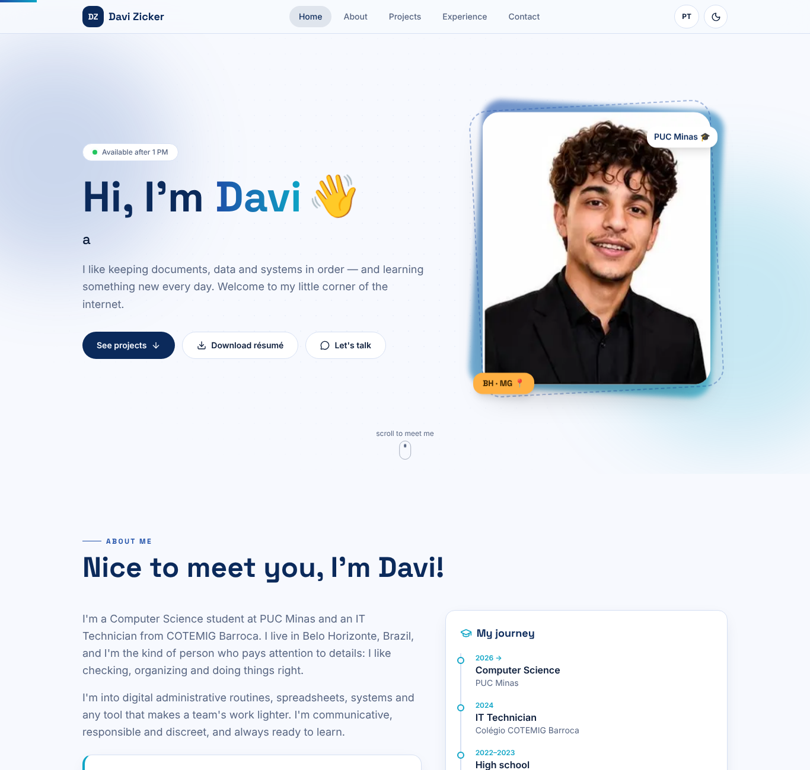
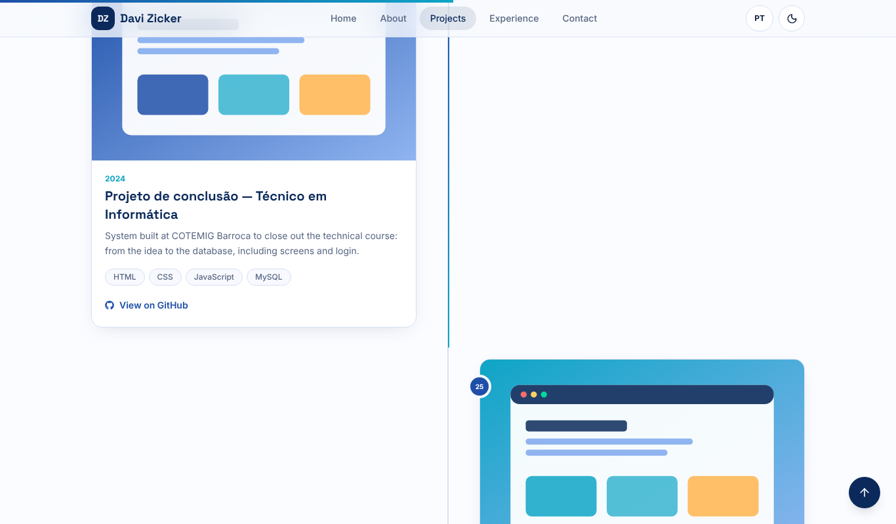
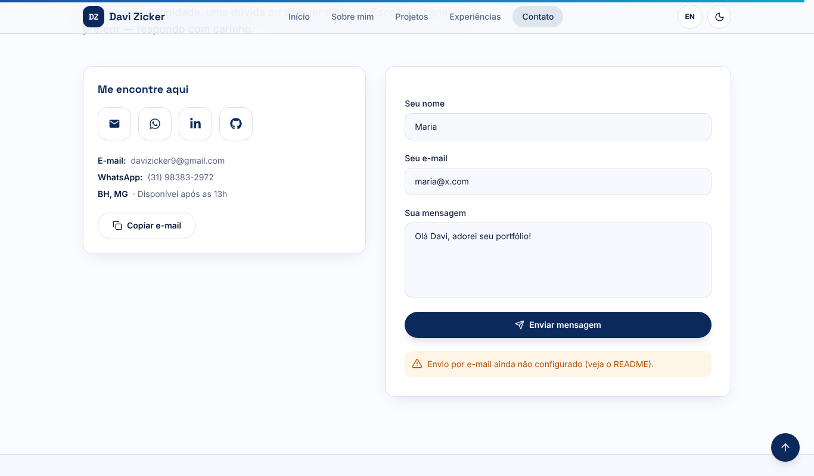
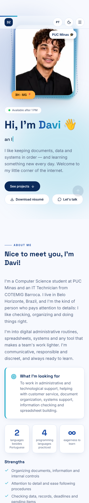

# Portfólio — Davi Furtado de Lacerda Zicker

Site de portfólio profissional do Laboratório 01 (DIW · PUC Minas): bilíngue (PT/EN), responsivo, com tema claro/escuro, timeline de projetos, experiências e formulário de contato funcional.

🔗 **Site publicado:** _TODO — cole aqui o link da Vercel após o deploy_






> Wireframes do Figma (Lab01S01): salvar os prints em `docs/wireframes/` e referenciar aqui. _TODO_

## Projetos em destaque
- **Lacuna** — startup de diagnóstico e matching de soluções (davizicker/STARTUP)
- **Portal / Painel SRE Metropolitana A** — dashboard institucional multi-setor com Supabase (davizicker/jerf e nte2coord-dev/PAINEL-METROPOLITANA)
- **Painel DIPE** — leitura de atos com OCR (React + Python) · **PUC Minas CC** — projetos do curso · **ADACCT** — fork para estudo
- **AV1 — Página de perfil (DIW)** — HTML/CSS (davizicker/AV1-DIW)
- **Este portfólio**

## Funcionalidades
- **Sobre mim** em português e inglês (botão PT/EN, preferência salva), trajetória, competências, idiomas e barras de skills por categoria.
- **Projetos** em timeline do mais antigo ao mais recente, com filtro por tecnologia, modal de detalhes, link do GitHub e imagem/GIF.
- **Experiências** com filtro por tipo (acadêmico, estágio, freela, open source, evento) e cartões expansíveis.
- **Contato** com ícones clicáveis (e-mail, WhatsApp, LinkedIn, GitHub), botão "copiar e-mail" e formulário com validação (Zod) e envio por EmailJS, com honeypot anti-spam e limite de reenvio (30 s).
- Scroll-spy, barra de progresso, tema claro/escuro, animações (respeitam `prefers-reduced-motion`), acessibilidade (teclado, aria, foco visível).

## Tecnologias e dependências
| Pacote | Uso |
|---|---|
| Next.js 14 (App Router) + React 18 + TypeScript | Framework e linguagem |
| Tailwind CSS 3 | Estilização (tokens via CSS variables) |
| Framer Motion | Animações e timeline |
| React Hook Form + Zod + @hookform/resolvers | Formulário e validação |
| @emailjs/browser | Envio de e-mail pelo front-end |
| next-themes | Tema claro/escuro |
| lucide-react, react-icons | Ícones |
| @fontsource-variable/inter, space-grotesk | Fontes |

## Estrutura de diretórios
```
├── docs/ (screenshots, wireframes)
├── public/ (images/davi.jpg, projects/, curriculo-davi-zicker.pdf, favicon.svg)
└── src/
    ├── app/ (layout, page, globals.css, not-found)
    ├── components/ (layout/, sections/, shared/)
    ├── context/LanguageContext.tsx
    ├── data/ (projects, experiences, skills, social)
    ├── hooks/  i18n/ (pt, en)  lib/ (emailjs, validators)  types/
```

## Rodando localmente
```bash
git clone <url-do-repositorio>
cd <pasta>
npm install
cp .env.example .env.local   # preencha as chaves do EmailJS
npm run dev                  # http://localhost:3000
npm run build && npm start   # produção
```

### Configurando o EmailJS
1. Crie uma conta gratuita em emailjs.com e adicione um *Email Service* (Gmail).
2. Crie um *Template* usando as variáveis `{{from_name}}`, `{{reply_to}}` e `{{message}}`.
3. Copie *Service ID*, *Template ID* e *Public Key* para `.env.local`.

## Deploy (Vercel)
1. Importe o repositório em vercel.com → *New Project*.
2. Em *Environment Variables*, adicione as três variáveis `NEXT_PUBLIC_EMAILJS_*`.
3. *Deploy* e cole o link acima.

## Personalizando o conteúdo
Edite `src/data/projects.ts`, `src/data/experiences.ts` e `src/data/social.ts` (links de LinkedIn/GitHub). Textos PT/EN em `src/i18n/`.

## Decisões de design
Paleta azul-marinho herdada do currículo, tom de voz próximo e acolhedor, foto em destaque, microinterações discretas e foco em leitura fácil no celular.
