---

# 🚗 AluguelCar — Sistema de Aluguel de Carros 👨‍💻

> [!NOTE]
> Sistema web para apoiar a gestão de aluguéis de automóveis: clientes fazem, consultam, modificam e cancelam pedidos pela internet; empresas e bancos (agentes) analisam o pedido financeiramente, concedem crédito e executam o contrato.

<table>
  <tr>
    <td width="800px">
      <div align="justify">
        Projeto do <b>Laboratório 02</b> da disciplina <b>Desenvolvimento de Interfaces Web (DIW)</b> — Engenharia de Software, PUC Minas (Prof. João Paulo Carneiro Aramuni). Implementado com <b>HTML5, CSS3 e JavaScript</b>, interface em <b>Bootstrap 5</b> e persistência em <b>JSON Server</b> (API REST simulada a partir do <code>db.json</code>) consumida via <b>Fetch API</b>. Inclui a modelagem UML completa (casos de uso, histórias de usuário, classes, pacotes e componentes).
      </div>
    </td>
  </tr>
</table>

---

## 🚧 Status do Projeto

       

---

## 📚 Índice
- [Links Úteis](#-links-úteis)
- [Sobre o Projeto](#-sobre-o-projeto)
- [Funcionalidades Principais](#-funcionalidades-principais)
- [Tecnologias Utilizadas](#-tecnologias-utilizadas)
- [Arquitetura](#-arquitetura)
- [Instalação e Execução](#-instalação-e-execução)
- [Deploy](#-deploy)
- [Estrutura de Pastas](#-estrutura-de-pastas)
- [Demonstração](#-demonstração)
- [Testes](#-testes)
- [Documentações utilizadas](#-documentações-utilizadas)
- [Autores](#-autores)
- [Contribuição](#-contribuição)
- [Agradecimentos](#-agradecimentos)
- [Licença](#-licença)

---

## 🔗 Links Úteis
* 🌐 **Demo Online:** _(preencher com a URL após o deploy — veja [Deploy](#-deploy))_
* 📖 **Modelagem UML:** [docs/modelagem.md](docs/modelagem.md)
* 📝 **Histórias de usuário:** [docs/historias-de-usuario.md](docs/historias-de-usuario.md)

---

## 📝 Sobre o Projeto
Locadoras e bancos precisam analisar, aprovar e formalizar aluguéis de veículos, muitas vezes com crédito associado. O **AluguelCar** centraliza esse fluxo na web:

- **Quem usa:** clientes (pessoas físicas) e agentes (empresas e bancos). *O sistema só pode ser utilizado após cadastro prévio.*
- **Fluxo:** o cliente introduz o pedido → o agente avalia financeiramente → com parecer positivo, o agente executa o contrato (com contrato de crédito de um banco, se solicitado) → o cliente acompanha o status.
- **Dados do contratante:** RG, CPF, nome, endereço, profissão e até **3** rendimentos (entidade empregadora + valor).
- **Propriedade do veículo:** conforme o tipo de contrato, o automóvel fica registrado como propriedade do cliente, de uma empresa ou de um banco.
- **Contexto:** acadêmico (Lab 02 – DIW).

---

## ✨ Funcionalidades Principais
- 🔐 **Cadastro prévio e login** de clientes e agentes (empresa/banco), com sessão e controle de perfil.
- 👤 **CRUD de clientes** (cadastro público, edição, consulta e exclusão) com validação de CPF/CNPJ, e-mail único e rendimentos (máx. 3).
- 🚘 **CRUD de automóveis** (matrícula, ano, marca, modelo, placa, diária e proprietário).
- 📋 **Pedidos de aluguel:** criar, consultar status, modificar e cancelar (cliente); avaliar e modificar (agente).
- 🧮 **Análise financeira:** renda total × valor do aluguel, com parecer obrigatório.
- 🏦 **Contrato de crédito** opcional com banco, parcela pela Tabela Price.
- 📄 **Contratos:** execução pelo agente, atualização do proprietário do veículo e consulta.
- 🛡️ **Regras e segurança:** conflito de datas, bloqueio de exclusões com vínculos ativos, recusa de ações sobre pedidos desatualizados, senhas com hash, CSP e escape contra XSS.
- 📱 **Responsivo** (Bootstrap 5, mobile-first).

---

## 🛠 Tecnologias Utilizadas

### 💻 Front-end
* **Estrutura e lógica:** HTML5, CSS3 e JavaScript (ES Modules, sem frameworks)
* **Interface:** [Bootstrap 5.3.3](https://getbootstrap.com/docs/5.3/) + Bootstrap Icons 1.11.3 (CDN)
* **Consumo da API:** [Fetch API](https://developer.mozilla.org/pt-BR/docs/Web/API/Fetch_API)

### 🖥️ Back-end (simulado)
* **Runtime:** Node.js ≥ 18
* **API e persistência:** [JSON Server 0.17.4](https://github.com/typicode/json-server) sobre o arquivo `db.json`
* `server.js` publica a API em `/api` e o front-end estático na raiz (um único serviço).

### ⚙️ Infraestrutura & DevOps
* **Hospedagem:** Render (`render.yaml` incluso) ou qualquer serviço Node.js
* **Modelagem:** PlantUML

---

## 🏗 Arquitetura
Aplicação **cliente-servidor em camadas**: páginas HTML (apresentação) → módulos JS por página (lógica) → núcleo compartilhado (`auth`, `ui`, `validators`) → `api.js` (acesso a dados via Fetch) → JSON Server → `db.json`. O sistema se divide nos dois subsistemas pedidos no enunciado: **gestão de pedidos e contratos** e **construção dinâmica das páginas web**.

Decisões e limitações:
- Um único processo Node serve o front-end e a API, evitando CORS e simplificando o deploy.
- Referências entre coleções por `id`; dados repetidos (rendimentos, parecer, crédito) ficam embutidos.
- **Segurança (camada sobre o JSON Server, em `server.js`):** senhas novas são gravadas com hash `scrypt` e nunca retornam pela API; o login é validado no servidor (`POST /api/login`, limite de 10 tentativas/min); cabeçalhos de segurança e CSP; escape de HTML no front-end.
- **Limitação (projeto acadêmico):** o JSON Server não tem controle de acesso por usuário, então as permissões por perfil são aplicadas no front-end e qualquer pessoa com acesso à URL consegue chamar a API diretamente. As contas de demonstração do `db.json` mantêm senha em texto puro só para facilitar a correção. Não use em produção.

| Casos de Uso | Classes |
| :---: | :---: |
| 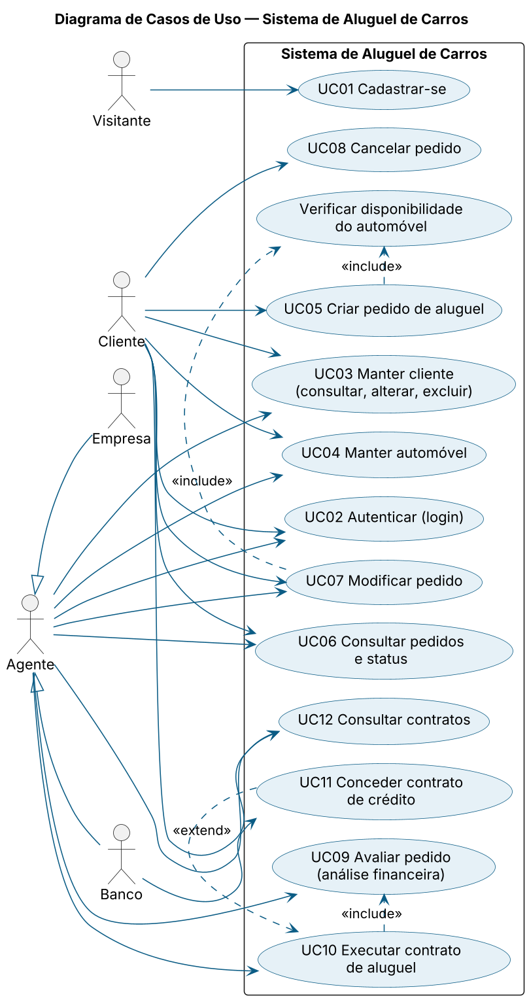 | 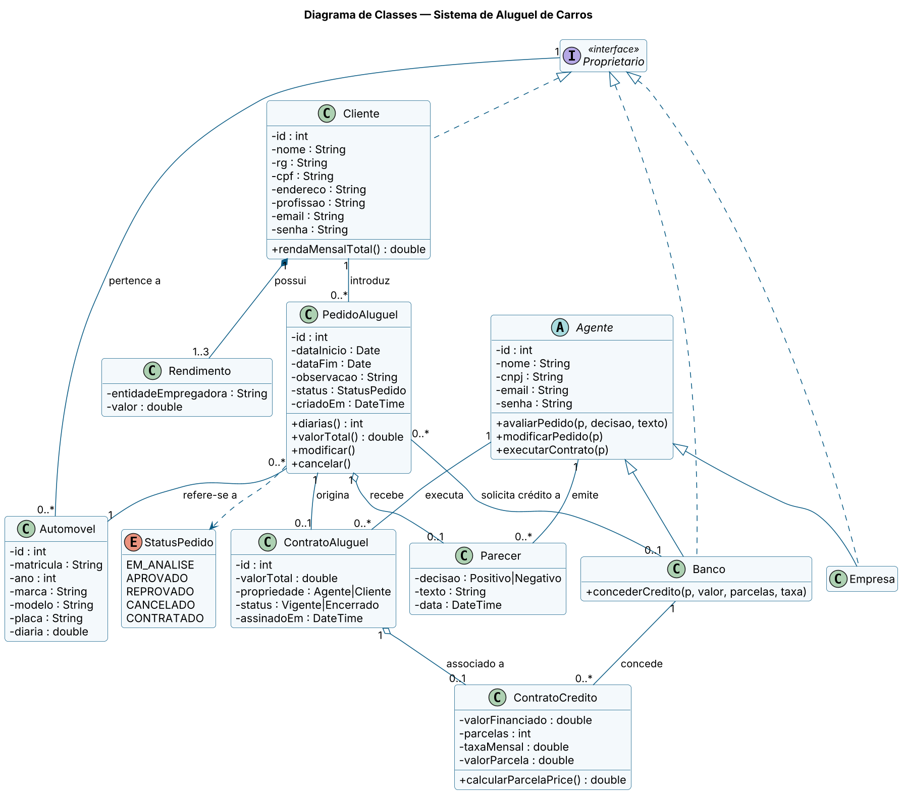 |
| **Pacotes (Visão Lógica)** | **Componentes** |
| 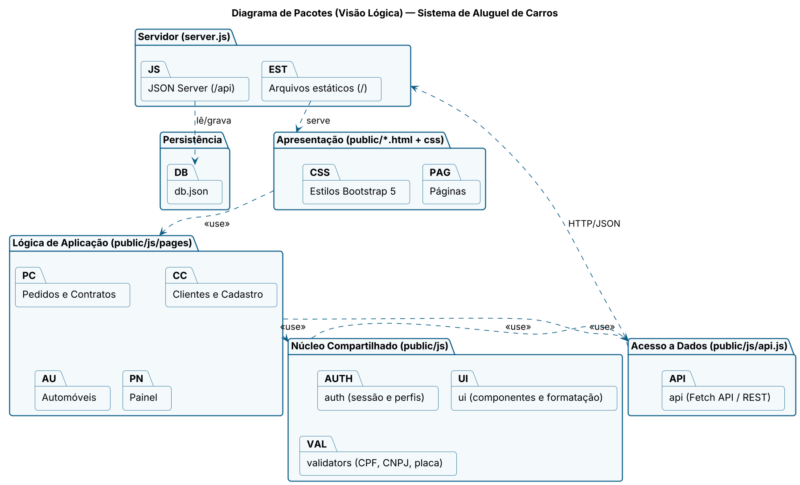 | 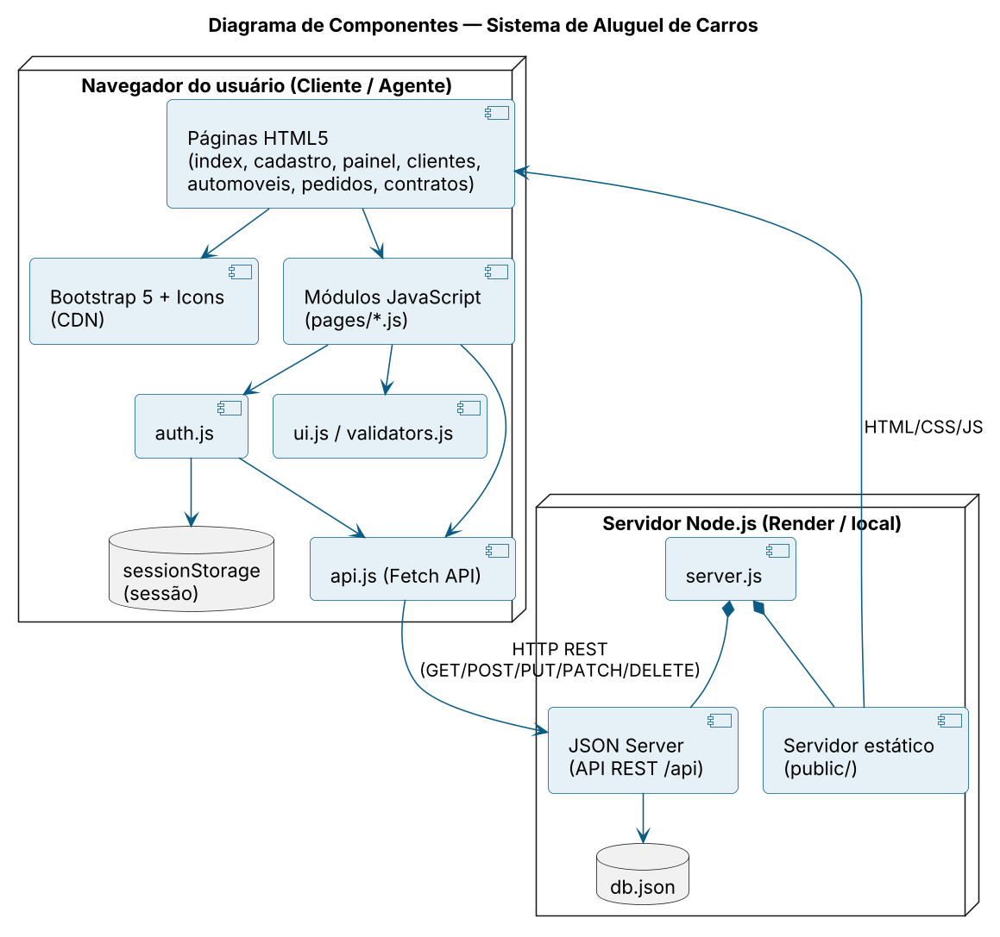 |

Também: [estados do pedido](docs/diagramas/estados-pedido.png) e [sequência pedido → contrato](docs/diagramas/sequencia-pedido-contrato.png).

---

## 🔧 Instalação e Execução

### Pré-requisitos
* [Node.js](https://nodejs.org/) 18 ou superior e npm.

### Como executar
```bash
git clone <url-do-repositorio>
cd <repositorio>/lab02-aluguel-de-carros
npm install
npm start
```
Acesse **http://localhost:3000** (front-end) — a API REST fica em **http://localhost:3000/api** (ex.: `/api/pedidos`).

Para restaurar os dados iniciais: `npm run reset-db` (usa `git checkout -- db.json`).

### 🔑 Contas de demonstração (senha: `123456`)
| Perfil | E-mail |
|---|---|
| Cliente | `maria@exemplo.com`, `carlos@exemplo.com` |
| Empresa | `empresa@exemplo.com` |
| Banco | `banco@exemplo.com`, `minascredito@exemplo.com` |

### Variáveis de ambiente (opcionais)
| Variável | Padrão | Uso |
|---|---|---|
| `PORT` | `3000` | Porta do servidor |
| `DB_FILE` | `./db.json` | Caminho do banco (use um disco persistente em produção) |

---

## 🚀 Deploy
O projeto precisa de um servidor Node.js (o JSON Server grava no `db.json`), portanto **não roda apenas em hospedagem estática** (GitHub Pages, Vercel estático).

**Opção recomendada — Render (gratuito, um único serviço):**
1. Envie o repositório ao GitHub.
2. No [Render](https://render.com): *New → Web Service* → selecione o repositório.
3. Configure: **Root Directory** `lab02-aluguel-de-carros` · **Build** `npm install` · **Start** `npm start` (ou use *Blueprint* com o `render.yaml`).
4. Após o deploy, abra a URL gerada e copie-a para a seção [Links Úteis](#-links-úteis).

> ⚠️ No plano gratuito o disco é efêmero: os dados voltam ao `db.json` do repositório a cada novo deploy/reinício. Para persistir, use um disco do Render e defina `DB_FILE`.

**Alternativa — front-end separado:** hospede a pasta `public/` em hospedagem estática, a API em outro serviço Node e ajuste `API_URL` em `public/config.js` (ex.: `https://meu-servico.onrender.com/api`).

---

## 📂 Estrutura de Pastas
```
lab02-aluguel-de-carros/
├── db.json                # Dados (JSON Server)
├── server.js              # API (/api), login seguro e arquivos estáticos
├── LICENSE
├── render.yaml            # Blueprint de deploy (Render)
├── docs/
│   ├── fontes/            # Diagramas PlantUML (.puml)
│   ├── diagramas/         # Diagramas renderizados (.png)
│   ├── screenshots/       # Capturas de tela
│   ├── historias-de-usuario.md
│   └── modelagem.md
├── scripts/               # reset-db e runner dos testes
├── tests/e2e.cjs          # Teste ponta a ponta (Playwright)
└── public/
    ├── *.html             # index, cadastro, painel, clientes, automoveis, pedidos, contratos
    ├── config.js          # URL da API
    ├── css/style.css
    └── js/
        ├── api.js  auth.js  ui.js  validators.js
        └── pages/         # Um módulo por página
```

---

## 🎥 Demonstração

| Login | Novo pedido |
| :---: | :---: |
| 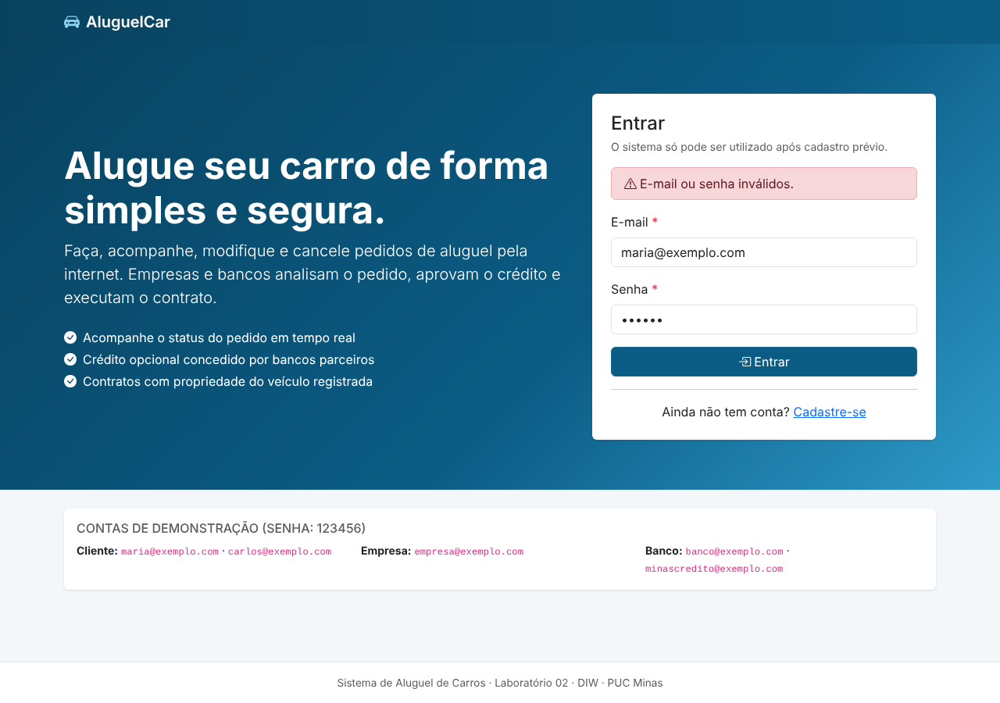 | 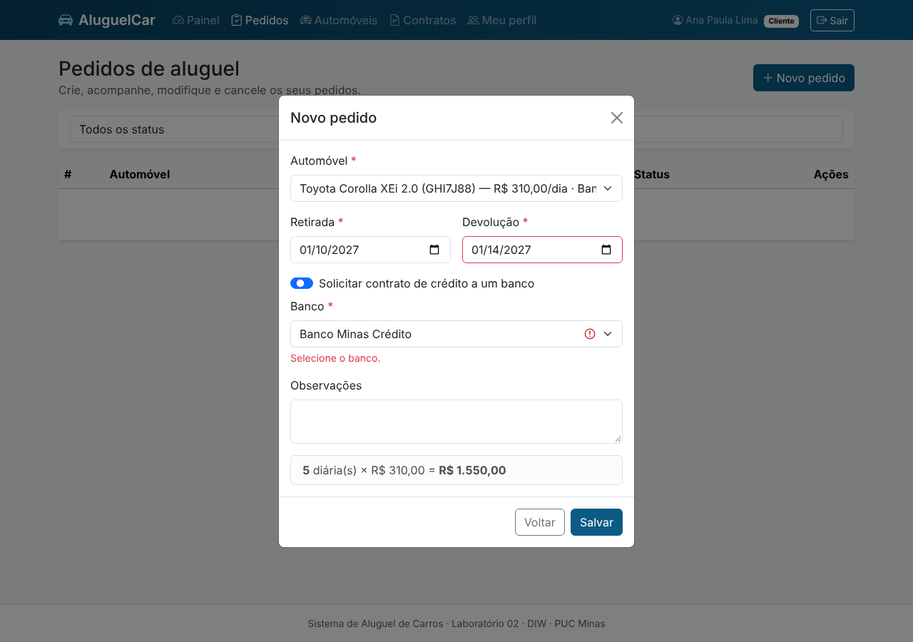 |
| **Pedidos do cliente** | **Contratos** |
| 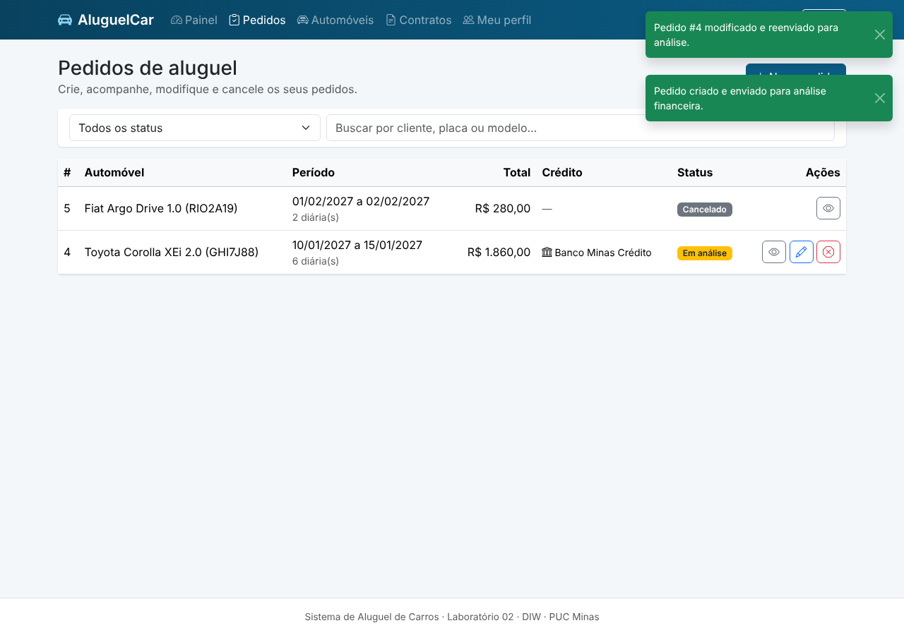 | 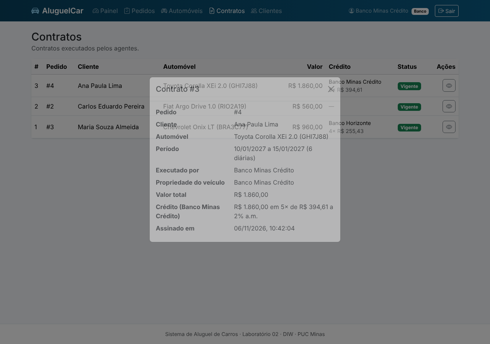 |
| **Clientes (visão do agente)** | **Automóveis** |
| 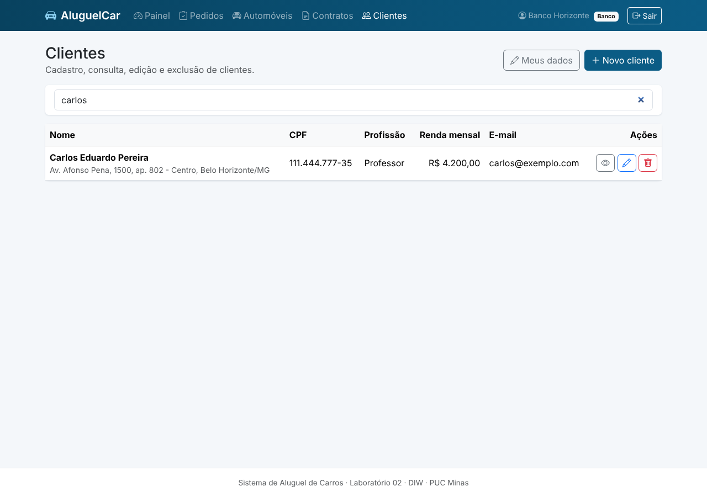 | 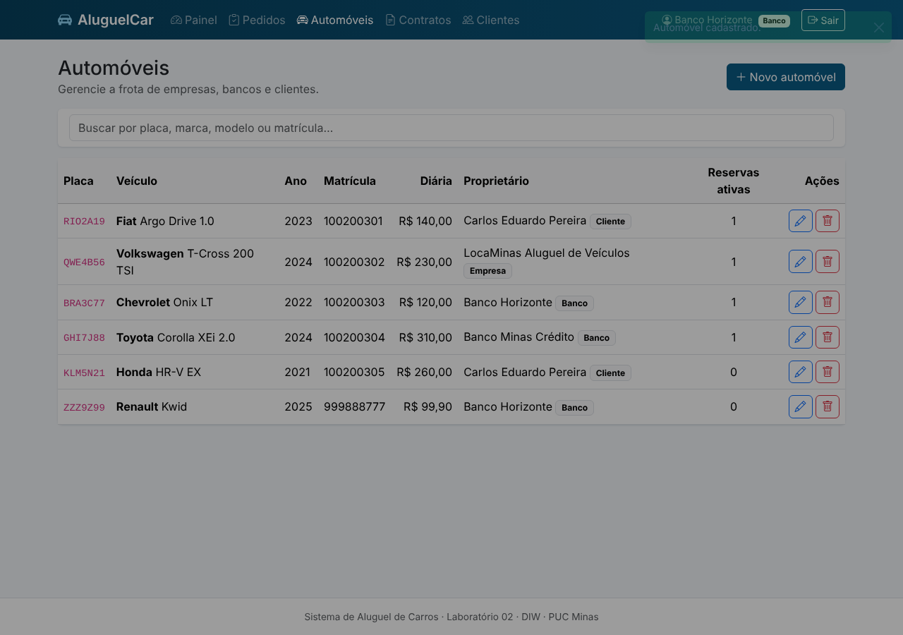 |

📱 **Mobile** (tabelas viram cartões):  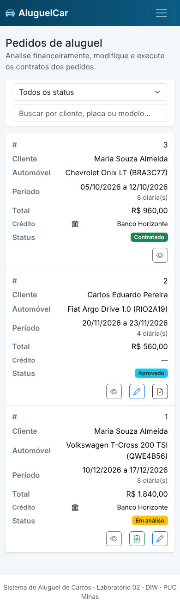

### 💻 Saída no terminal
```text
$ npm start
Aluguel de Carros rodando em http://localhost:3000
API REST (JSON Server):     http://localhost:3000/api/clientes
```

---

## 🧪 Testes
Teste ponta a ponta em navegador real (Playwright) cobrindo cadastro e validações, login, criar/modificar/cancelar pedidos, conflito de datas, avaliação, contrato com e sem crédito, troca de proprietário, CRUD de clientes e automóveis, bloqueios de exclusão, rotas protegidas e ausência de erros no console (**52 verificações**, incluindo segurança do servidor).

```bash
npm i --no-save playwright && npx playwright install chromium
npm run test:e2e     # usa uma cópia temporária do db.json (o original não é alterado)
```

---

## 🔗 Documentações utilizadas
* 📖 [Bootstrap 5](https://getbootstrap.com/docs/5.3/getting-started/introduction/)
* 📖 [JSON Server](https://github.com/typicode/json-server/tree/v0.17.4)
* 📖 [Fetch API (MDN)](https://developer.mozilla.org/pt-BR/docs/Web/API/Fetch_API)
* 📖 [Diagrama de Pacotes (UML)](https://www.uml-diagrams.org/package-diagrams.html)
* 📖 [Conventional Commits](https://www.conventionalcommits.org/en/v1.0.0/)

---

## 👥 Autores
| 👤 Nome | :octocat: GitHub | 📤 E-mail |
|---|---|---|
| Davi Furtado de Lacerda Zicker | [davizicker](https://github.com/davizicker) | [claudavizicker@gmail.com](mailto:claudavizicker@gmail.com) |

---

## 🤝 Contribuição
1. Faça um `fork` do projeto.
2. Crie uma branch (`git checkout -b feature/minha-feature`).
3. Commit com [Conventional Commits](https://www.conventionalcommits.org/en/v1.0.0/) (`git commit -m 'feat: adiciona X'`).
4. `git push origin feature/minha-feature` e abra um **Pull Request**.

---

## 🙏 Agradecimentos
* [**Engenharia de Software PUC Minas**](https://www.instagram.com/engsoftwarepucminas/) — pelo apoio institucional e estrutura acadêmica.
* [**Prof. Dr. João Paulo Aramuni**](https://github.com/joaopauloaramuni) — pelos ensinamentos e pelo template de README.

---

## 📄 Licença
Distribuído sob a **Licença MIT**.

---
