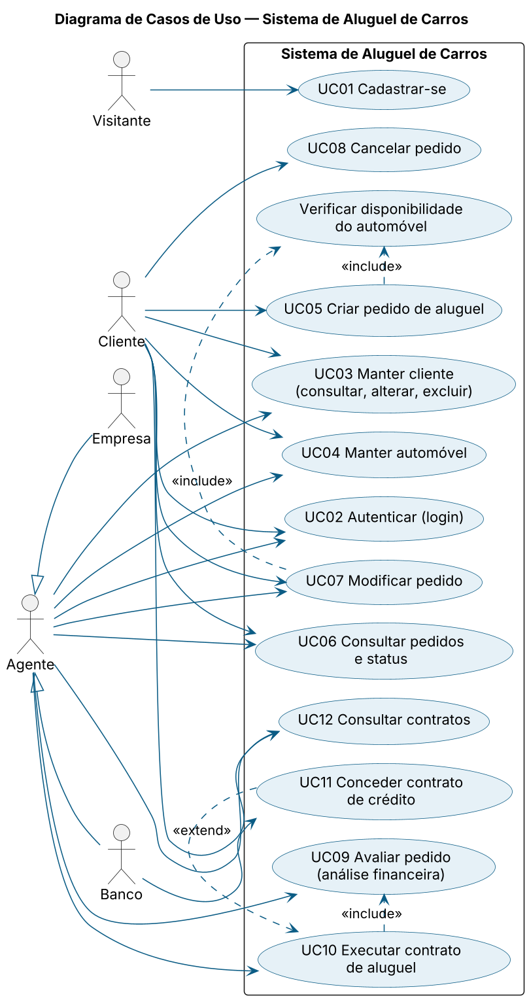
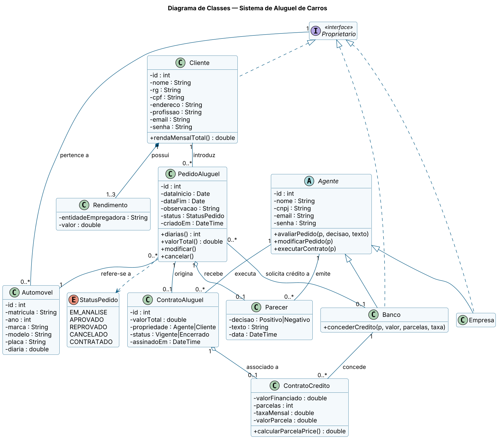
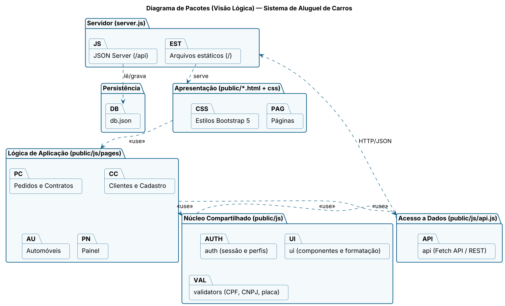
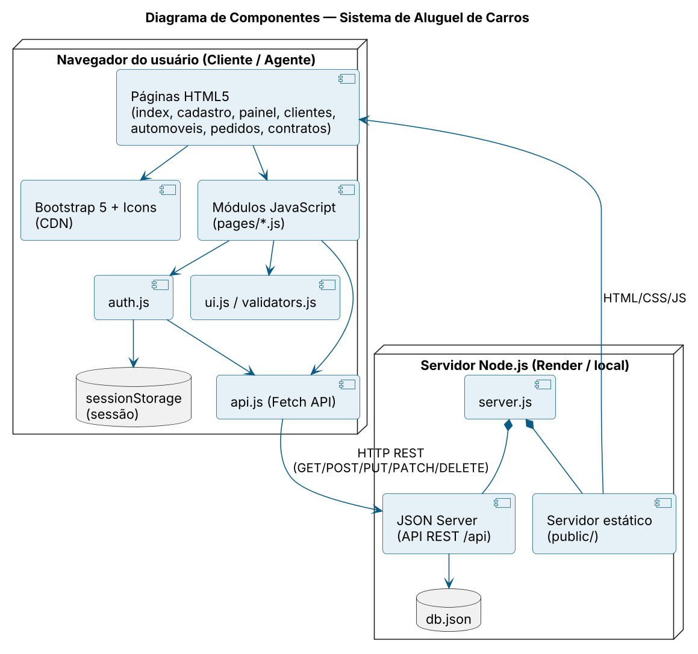
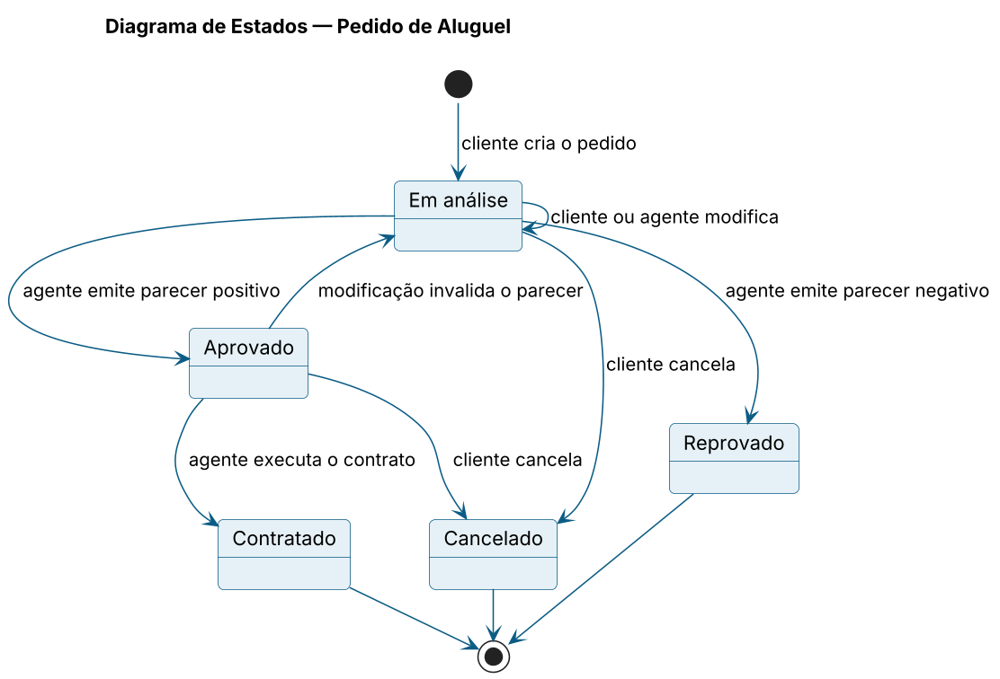
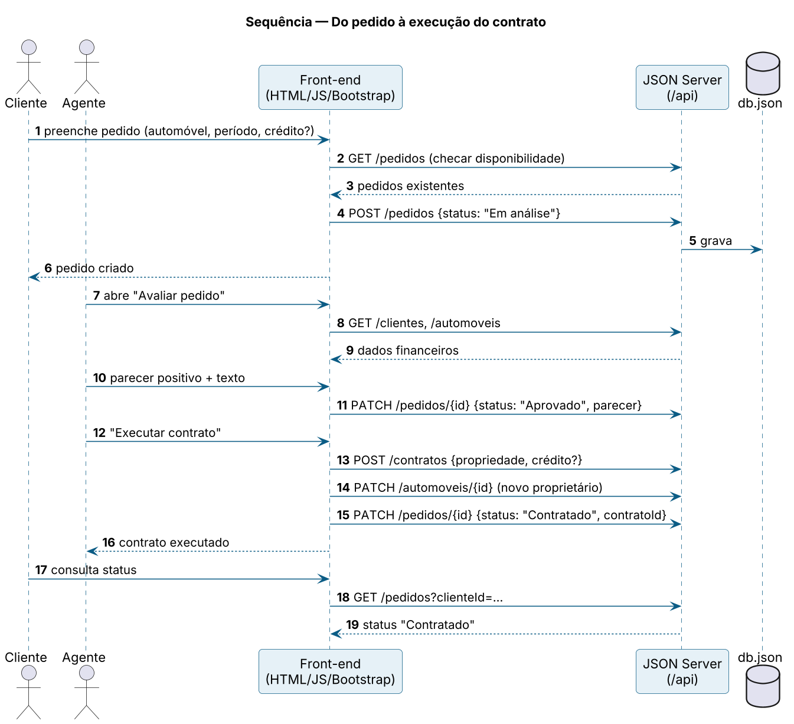

# Modelagem do Sistema

Fontes PlantUML em [`fontes/`](fontes) e imagens renderizadas em [`diagramas/`](diagramas). Para regenerar:
`java -jar plantuml.jar -tpng fontes/*.puml -o ../diagramas`.

## 1. Casos de Uso

## 2. Histórias de Usuário
Veja [historias-de-usuario.md](historias-de-usuario.md).

## 3. Diagrama de Classes

Mapeamento para o JSON Server (`db.json`): `clientes` (com `rendimentos[]` embutidos), `agentes` (`tipo` = `empresa` | `banco`), `automoveis` (`proprietarioTipo` + `proprietarioId`), `pedidos` (com `parecer` e `credito` embutidos) e `contratos` (com `credito` embutido).

## 4. Diagrama de Pacotes (Visão Lógica)

## 5. Diagrama de Componentes

## 6. Diagramas complementares
Estados do pedido:

Sequência do pedido ao contrato:

## Histórico de revisões
| Versão | Alteração |
|---|---|
| 1.0 | Modelos iniciais e primeira implementação. |
| 1.1 | Regra de disponibilidade por período e "modificação reabre análise" incluídas nos modelos após a implementação do protótipo. |
